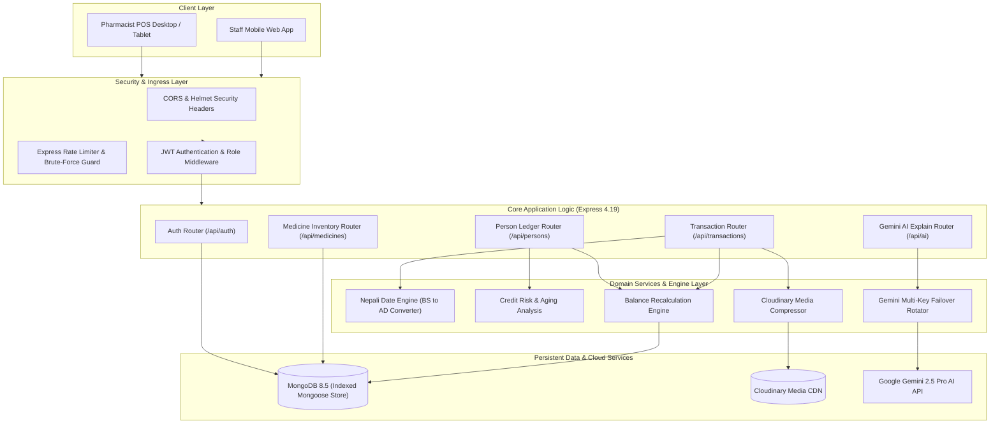
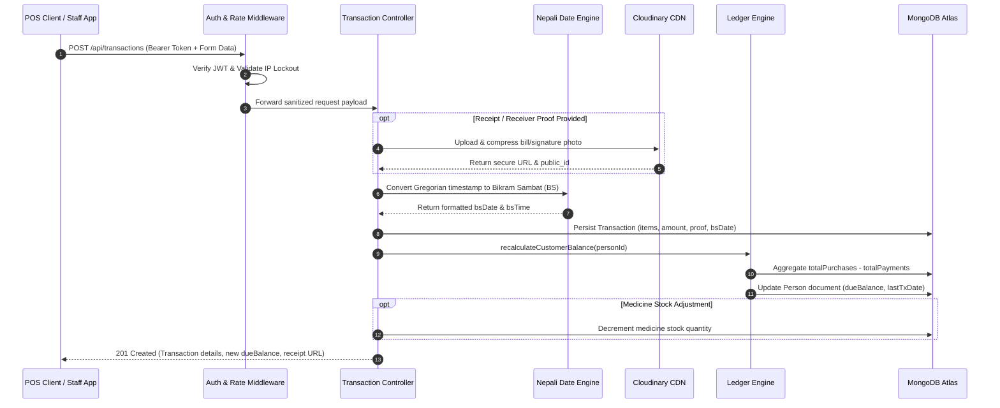

# Soni Surgical & Medical Store — Credit, Due & Inventory Ledger Backend

[](https://opensource.org/licenses/MIT)
[](https://nodejs.org/)
[](https://expressjs.com/)
[](https://www.mongodb.com/)
[%202081+-D9381E)](https://en.wikipedia.org/wiki/Bikram_Sambat)
[](https://deepmind.google/technologies/gemini/)
[](https://cloudinary.com/)
[](https://vercel.com/)

---

## 📋 Executive Summary & Problem Solved

Community medical stores, surgical wholesalers, and pharmacies operating across South Asia—especially in Nepal—face unique operational challenges that standard Western accounting software fails to address:

1. **Dual Calendar Reality**: Daily retail transactions, billing statements, and customer credit promises occur in **Bikram Sambat (BS)**, while underlying operating systems, servers, and cloud databases persist timestamps in **Gregorian (AD)**.
2. **Informal & Rolling Customer Credit**: Community healthcare relies heavily on trust-based credit lines ("Udharo") where patients take urgent medications and clear balances incrementally or through family members.
3. **Disputed Transactions & Missing Receipts**: Hand-written ledger books ("Khata") are easily lost, damaged, or contested by customers when family members collect medication on their behalf.
4. **Pharmaceutical Complexity & Patient Queries**: Pharmacists constantly field dosage, drug interaction, and veterinary vs. human formulation queries in high-pressure store environments.

**Soni Surgical Backend** provides an enterprise-grade, cloud-native RESTful API engine custom-built for medical retailers. It unites automated **BS-to-AD calendar synchronization**, customer debt risk scoring, Cloudinary-compressed digital receipt proofs, audit-proof transaction ledgers, and **Google Gemini Multimodal AI** with resilient multi-key round-robin failover.

---

## ✨ Key Features

- 📅 **Dual Bikram Sambat (BS) & Gregorian (AD) Engine**: Native conversion and bidirectional indexing (`nepali-date-converter`), tracking transactions with accurate BS dates (`2082-04-28`), BS timestamps, and sub-millisecond sorting.
- 💳 **Customer Credit & Debt Ledger System**: Instant calculation of total purchases, cumulative payments received, and net outstanding due balances per customer.
- 📸 **Cloudinary Proof Receipt Archival**: Built-in photo compression and cloud attachment pipeline for hand-signed bills, prescription slips, and receiver signatures.
- 🤖 **Gemini Multimodal Clinical & Drug Assistant**: Multimodal AI route with quad-key rotation (`GEMINI_API_KEY_1` to `GEMINI_API_KEY_4`) for pharmaceutical explanations, dosage summaries, veterinary vs. human drug differentiation, and medicine photo resolution.
- 💊 **Inventory & Stock Management**: Real-time stock decrement, low-inventory notifications, categorical grouping (Human, Veterinary, Herbal), and auto-complete suggestion indexes.
- 🛡️ **Defensive Security & Rate Limiting**: In-memory IP-based brute force protection (10 attempts, 15-minute lockout), Helmet HTTP protection, and JWT role-based access control (`admin`, `staff`).
- ⚡ **Automated Archive & Prune Engine**: High-volume data pruning engine that consolidates historic transactions into balance forward entries while preserving audit trails.
- 🚀 **Hybrid Runtime Deployment**: Fully optimized for both long-running Node.js daemon processes (`server.js`) and Vercel serverless edge functions (`api/index.js`).

---

## 🏗️ System Architecture



---

## 🔄 Transaction & Credit Recording Sequence



---

## 🛠️ Tech Stack

| Domain | Technology | Description |
| :--- | :--- | :--- |
| **Runtime** | Node.js (v18.x - v22.x LTS) | Event-driven JavaScript runtime engine |
| **Web Framework** | Express.js (v4.19.2) | Fast, unopinionated minimalist web framework |
| **Database** | MongoDB (Mongoose v8.5.1) | Document-oriented NoSQL database with indexed schemas |
| **Calendar Engine** | `nepali-date-converter` (v3.3.4) | Precise Bikram Sambat to Gregorian conversion algorithms |
| **AI Multimodal** | Google Gemini 2.5 Pro | Drug interaction analysis, OCR parsing, clinical queries |
| **Media Storage** | Cloudinary SDK (v2.10.0) | Cloud-based receipt compression and image CDN hosting |
| **Security & Auth** | JSON Web Tokens (`jsonwebtoken` v9.0) | Stateless claims-based authentication |
| **Password Security**| `bcryptjs` (v3.0.3) | Salted one-way cryptographic password hashing |
| **HTTP Hardening** | `helmet` (v8.3.0) + `cors` | HTTP response headers protection and origin control |
| **Rate Limiting** | `express-rate-limit` (v8.6.2) | IP throttling and automated brute-force defence |
| **Hosting & Cloud** | Vercel Serverless / Docker / PM2 | Serverless edge deployment or self-hosted container daemon |

---

## 📂 Repository Directory Structure

```text
sonisurgical-backend/
├── api/
│   └── index.js                      # Serverless entry point for Vercel
├── src/
│   ├── config/
│   │   └── db.js                     # MongoDB connection pool & error handling
│   ├── middleware/
│   │   └── auth.js                   # JWT verification & role authorization (protect, authorize)
│   ├── models/
│   │   ├── Medicine.js               # Medicine inventory, batches, dosage form, stock
│   │   ├── MedicineSuggestion.js     # Cached drug name search index
│   │   ├── Person.js                 # Customer/patient profile, due balance, credit limit
│   │   ├── Transaction.js            # Ledger records: purchase/payment, BS timestamp, proof
│   │   └── User.js                   # Staff & Admin user accounts with bcrypt hooks
│   ├── routes/
│   │   ├── aiExplain.js              # Gemini 2.5 Pro drug chat & clinical explanation
│   │   ├── auth.js                   # Login, registration, password updates, brute-force guard
│   │   ├── medicines.js              # Inventory CRUD, stock adjustment, auto-complete
│   │   ├── persons.js                # Customer directory, debt leaderboard, risk analysis
│   │   └── transactions.js           # Ledger entry creation, historical queries, pruning
│   ├── utils/
│   │   ├── archiveService.js         # Transaction archiving & data pruning pipeline
│   │   ├── cloudinaryService.js      # Image upload & CDN transformation helper
│   │   ├── ledgerService.js          # Atomic customer debt & credit recalculations
│   │   ├── medicineNamesService.js   # Fast pharmaceutical name normalizer
│   │   ├── nepaliDate.js             # Bikram Sambat date formatting & helpers
│   │   ├── risk.js                   # Customer risk classification algorithm
│   │   └── securityUtils.js          # Input sanitization and data masking
│   └── index.js                      # Express app configuration & middleware pipeline
├── .env.example                      # Sanitized environment configuration template
├── .gitignore                        # Git ignore specifications
├── package.json                      # Project dependencies and script declarations
├── server.js                         # Production Node.js HTTP server listener
└── vercel.json                       # Vercel serverless routing rewrite rules
```

---

## ⚙️ Local Setup & Installation

### Prerequisites
- **Node.js**: v18.0.0 or higher ([Download Node.js](https://nodejs.org/))
- **MongoDB**: Local MongoDB instance running on port `27017` or MongoDB Atlas URI
- **Cloudinary Account**: Cloud name, API Key, and Secret
- **Google AI Studio Account**: At least one Gemini API Key

### 1. Clone & Install Dependencies
```bash
# Navigate to repository directory
cd c:\Users\pandi\OneDrive\Desktop\github\sonisurgical-backend

# Install production and development dependencies
npm install
```

### 2. Configure Environment Variables
Create a `.env` file in the project root:
```bash
cp .env.example .env
```

Populate the `.env` configuration:
```env
PORT=5000
MONGO_URI=mongodb://127.0.0.1:27017/medical_shop

# Cloudinary Configuration for Image Storage
cloudanary_name=your_cloud_name
cloudanary_API_key=your_api_key
cloudanary_secret_key=your_secret_key

# Google Gemini API Keys for Multimodal AI Analysis (supports round-robin rotation)
GEMINI_API_KEY_1=your_gemini_api_key_1
GEMINI_API_KEY_2=your_gemini_api_key_2
GEMINI_API_KEY_3=your_gemini_api_key_3
GEMINI_API_KEY_4=your_gemini_api_key_4

# JWT Authentication
JWT_SECRET=your_super_secret_jwt_key_here
JWT_EXPIRES_IN=7d

# Initial Admin Credentials (Optional override)
ADMIN_EMAIL=admin@sonisurgical.com
ADMIN_PASSWORD=change_this_password
```

### 3. Launch Development Server
```bash
# Start server with live reload via nodemon
npm run dev

# Or start in standard production mode
npm start
```
The server will bind to `http://localhost:5000` and automatically verify MongoDB connectivity.

---

## 📡 Complete API Reference

### 🔐 Authentication (`/api/auth`)

| Method | Endpoint | Description | Auth Required |
| :--- | :--- | :--- | :--- |
| `POST` | `/api/auth/login` | Authenticate staff/admin with brute-force lockout guard | Public |
| `POST` | `/api/auth/register` | Register new staff member (requires admin permission) | Public / Admin |
| `GET` | `/api/auth/verify` | Verify existing JWT token validity | Bearer Token |
| `GET` | `/api/auth/me` | Fetch active user profile and roles | Bearer Token |
| `POST` | `/api/auth/change-password` | Update authenticated user password | Bearer Token |
| `GET` | `/api/auth/users` | List all staff members and statuses | Admin Only |
| `POST` | `/api/auth/logout` | Invalidate client session cookie | Bearer Token |

### 👥 Customer & Debt Ledger (`/api/persons`)

| Method | Endpoint | Description | Auth Required |
| :--- | :--- | :--- | :--- |
| `GET` | `/api/persons` | Search and filter customers by name, phone, or balance | Bearer Token |
| `POST` | `/api/persons` | Create new customer profile with credit limit | Bearer Token |
| `GET` | `/api/persons/leaderboard` | Top debtor leaderboard sorted by outstanding due | Bearer Token |
| `GET` | `/api/persons/risk` | Credit risk distribution analysis (Low, Moderate, High) | Bearer Token |
| `GET` | `/api/persons/:id` | Get customer profile with full transaction history | Bearer Token |
| `PUT` | `/api/persons/:id` | Update customer phone, address, or credit limit | Bearer Token |
| `DELETE` | `/api/persons/:id` | Remove customer profile (requires zero balance) | Admin Only |
| `POST` | `/api/persons/:id/recalculate` | Recompute aggregate ledger balance from raw transactions | Bearer Token |

### 🧾 Transactions & Receipts (`/api/transactions`)

| Method | Endpoint | Description | Auth Required |
| :--- | :--- | :--- | :--- |
| `POST` | `/api/transactions` | Record purchase or payment, upload proof photo, assign BS date | Bearer Token |
| `GET` | `/api/transactions` | Query transactions filtered by customer, date range (BS/AD), type | Bearer Token |
| `DELETE` | `/api/transactions/:id` | Void a transaction and rebalance customer ledger | Admin Only |
| `GET` | `/api/transactions/archive/preview` | Preview transactions eligible for archival pruning | Admin Only |
| `POST` | `/api/transactions/archive/prune` | Execute pruning of historic records with balance carryover | Admin Only |

### 💊 Medicine Inventory (`/api/medicines`)

| Method | Endpoint | Description | Auth Required |
| :--- | :--- | :--- | :--- |
| `GET` | `/api/medicines` | Query catalog with fuzzy search, category filter, stock status | Bearer Token |
| `POST` | `/api/medicines` | Register new pharmaceutical or surgical product | Bearer Token |
| `GET` | `/api/medicines/suggestions` | Rapid prefix auto-complete for POS billing interface | Bearer Token |
| `GET` | `/api/medicines/stats` | Inventory metrics: total SKUs, low-stock count, valuations | Bearer Token |
| `GET` | `/api/medicines/:id` | Retrieve detailed product information and batch data | Bearer Token |
| `PUT` | `/api/medicines/:id` | Update pricing, strength, category, or reorder levels | Bearer Token |
| `POST` | `/api/medicines/:id/adjust-stock`| Audit adjustment: manual stock increment or decrement | Bearer Token |
| `DELETE` | `/api/medicines/:id` | Delete medicine item from active catalog | Admin Only |
| `POST` | `/api/medicines/seed` | Seed default inventory list for initial store bootstrap | Admin Only |

### 🧠 Gemini Multimodal AI Assistant (`/api/ai`)

| Method | Endpoint | Description | Auth Required |
| :--- | :--- | :--- | :--- |
| `POST` | `/api/ai/explain` | Comprehensive clinical explanation of medicine, dosage & warnings | Bearer Token |
| `POST` | `/api/ai/chat` | Interactive pharmaceutical chatbot with key rotation failover | Bearer Token |

---

## 🚢 Production Deployment

### Option A: Vercel Serverless
The repository is pre-configured with `vercel.json` and `api/index.js` for instant serverless deployment:
```bash
# Install Vercel CLI
npm install -g vercel

# Deploy to Vercel
vercel --prod
```
Configure your environment variables (`MONGO_URI`, `JWT_SECRET`, `cloudanary_*`, `GEMINI_API_KEY_*`) in the **Vercel Project Dashboard** under Settings > Environment Variables.

### Option B: Linux Server / PM2 Daemon
```bash
# Install PM2 process manager
npm install -g pm2

# Start clustered daemon
pm2 start server.js --name "sonisurgical-api" -i max

# Save process list and generate startup script
pm2 save
pm2 startup
```

---

## 🛡️ Security, Performance & Best Practices

- **Zero-Trust Input Validation**: All incoming requests are sanitized and type-cast before hitting database queries to eliminate NoSQL injection vulnerabilities.
- **Failover-Safe Multi-Key Rotation**: The Gemini AI client dynamically balances API calls across 4 distinct keys, transparently falling back when rate limits (HTTP 429) or quota errors are encountered.
- **Bikram Sambat Indexing Optimization**: High-speed compound indexes (`{ person: 1, createdAt: -1 }` and `{ bsDate: -1, createdAt: -1 }`) ensure instant query execution even with hundreds of thousands of ledger entries.
- **Atomic Balance Integrity**: Ledger recalculations utilize MongoDB atomic operations and transactions, preventing race conditions during concurrent POS sales.

---

## 📄 License
This project is licensed under the [MIT License](LICENSE).
